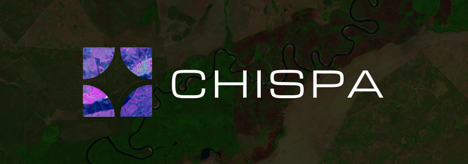

CHISPA merges fire detections from different sources into one alert for each fire.
It measures how good those alerts are, and it publishes the result: good or bad.
Each part of an alert must say how we know it.

## The vision

A brigade gets fire data from many places. Polar-orbit satellites see small fires, but only a few times each day.
Geostationary satellites look every 10 minutes, but with large pixels. The same fire can show as many records, and some records are not fires.

The goal is one alert for each fire. Today CHISPA gives one alert for each event: a group of detections that it assigns to one fire. One event is not always one fire, and finding 3 has the numbers. The alert says how much to trust it, with a measured track record.
It says what the fire does, what it can reach, and what the satellites could not see.
We do not tell a brigade a thing that we did not measure.

## What we found

Each finding has a command that makes it again. Findings 1 to 6, 8 and 9 have a hypothesis that we wrote before the run. Finding 7 came after its run on 2024. Its statement for 2025 came before that run.
A negative result is here in the same way as a positive result.
The first numbers of a finding are for 2024, with satellite sources only, in the Brazilian part of the Pantanal. The rules come from 2023.
2024 was the test year of the merge (findings 1 to 3). The later parts used 2024 to examine their rules. Their test year is 2025. Each finding has a run on 2025: a year with 589 counted fires, and 2024 has 4246. Each link goes to the table in [results/SUMMARY.md](results/SUMMARY.md). [docs/method.md](docs/method.md) has each method, in the section that the finding names.

1. **The merge finds more fires, by a small amount.** It found 2864 of 4246 mapped fires. GOES, the best single sensor family, found 2668. Almost all of the gain is fires smaller than 100 hectares. In 2025 it found 306 of 589, and GOES found 270. FIRMS alone, with three sensor families, found 302. ([configurations](results/SUMMARY.md#2024-configurations), [2025](results/SUMMARY.md#2025-configurations), method 11.2 and 11.4)
2. **The merge is not earlier for the typical fire.** It is earlier where GOES was late: on 30 of 140 isolated fires, a polar-orbit satellite was first. A simple comparison showed GOES hours before VIIRS. That lead came from the large GOES pixel, which reaches the fires adjacent to its fire. In 2025 a polar-orbit satellite was first on 11 of 76 isolated fires. ([merge_gain](results/SUMMARY.md#2024-merge_gain), [2025](results/SUMMARY.md#2025-merge_gain), method 11.2 and 11.6)
3. **The confidence level has a measured meaning.** 1273 of 1582 HIGH events matched a mapped fire, and 1511 of 2914 LOW events. An event is not always one fire: 1104 of the 2864 fires that we found are in one event only. In 2025: 214 of 407 HIGH events, and 252 of 959 LOW events. The sequence of the levels is the same in each year. The matched share of a level is not. ([events](results/SUMMARY.md#2024-events), [2025](results/SUMMARY.md#2025-events), method 10.3 and 11.2)
4. **An alert with no mapped fire is not always a false alarm.** A rule on Sentinel-2 images said "burned" for 153 of 298 unmatched HIGH events with a clear view. For those with no mapped fire of the year in their box it was 94 of 209. For HIGH events with a match it was 82 of 97, and for boxes with no fire 22 of 98. In 2025 it was 93 of 186, 83 of 100 with a match, and 17 of 100 boxes with no fire. The rule is weak: read the numbers together. In pictures, with up to three views of each place, a person said "burned" for 22 of 50 unmatched HIGH events with a clear answer, for 18 of 25 with a match, and for 3 of 57 boxes with no fire. In 2025: 6 of 23, 16 of 18 and 0 of 30. ([burn_check](results/SUMMARY.md#2024-burn_check), [image_check_2](results/SUMMARY.md#2024-image_check_2), method 11.10)
5. **We found no sign that cloud is the main cause of a fire with no detection.** GOES examined the place of a typical such fire in 76 percent of the hourly scans of its months (1382 fires). The table uses the months of a fire, not its hours: a short fire under cloud stays possible. In 2025 the median was also 76 percent of the scans of a fire (283 fires). ([visibility](results/SUMMARY.md#2024-visibility), [2025](results/SUMMARY.md#2025-visibility), method 11.11)
6. **We can measure where a fire goes, not how much it burned.** A VIIRS pixel is as large as a small fire, thus we give no burned area. In 1736 of 4546 steps of 6 to 18 hours, a new pixel was past a floor of 850 m. The floor comes from the steps of less than 2 hours, where a fire moves little: 1691 of 10 697 of those steps also had such a pixel. In 2025: 118 of 377 steps, and 144 of 1242. For fires of some days, the advance of VIIRS and the new burned ground of two Sentinel-2 images agreed to a factor of 2 for 23 of 34 events in 2023 and for 57 of 80 in 2024. Their directions agreed to 45 degrees for 24 of 34 and for 56 of 80. 2025 has 5 such events: too few for an answer (method 11.20). ([growth_steps](results/SUMMARY.md#2024-growth_steps), [2025](results/SUMMARY.md#2025-growth_steps), method 11.12 and 11.13)
7. **The first day separates the alerts.** 24 hours after its first detection, 357 of 404 alerts with a severity of 50 or more matched a mapped fire, and 253 of those had a later detection. Below 25, 1131 of 3358 matched, and 141 of those had one. In 2024 the number of detections alone separated the alerts a little better (0.6742 against 0.6678). We found this after the run on 2024. With the statement written before the run, 2025 gave: 50 of 63 alerts of 50 or more matched, and 30 of those had a later detection. Below 25: 107 of 1196, and 7 of those. ([severity](results/SUMMARY.md#2024-severity), [2025](results/SUMMARY.md#2025-severity), method 11.14)
8. **A severity number shows priorities. It is not a forecast.** Its rank correlation with the final burned area was 0.2838. For the number of detections alone it was 0.3155. In 2025 the two values were 0.3751 and 0.2679, and the fire power alone had 0.391. No measure was the best in each year. For the alerts with a match only, the severity was not better in 2025 (0.3143 against 0.3174): its gain is the separation of the alerts with a match, not the sequence of the areas. ([severity_rank](results/SUMMARY.md#2024-severity_rank), [2025](results/SUMMARY.md#2025-severity_rank), method 11.14)
9. **A small model puts new alerts in a better sequence than the level.** The numbers are for 2025, a year that gave the model no weight. Thirty minutes after the first detection of an alert, 126 of the 175 alerts with the largest values matched a mapped fire. For the level it was 35 of 175. The detections of those alerts matched 125 different fires, and 43 for the level. The match separation was 0.839 against 0.6075 (1755 alerts, 354 with a match). This is a second analysis of 2025, after a correction of the unit: the first test, on the events of the end of the year, gave the same answer. The value is not a correct probability: it is too low. Thus we give a rank. On 2026, a year with no map, the outcome was the burn curve: 108 of the 110 alerts with the largest values had a burn, and 59 of 110 for the level ([confidence_curve](results/SUMMARY.md#2026-confidence_curve), method 11.18). ([confidence](results/SUMMARY.md#2025-confidence), [calibration](results/SUMMARY.md#2025-confidence_calibration), method 11.15)

## The stages of a fire

All the work follows eight stages. Each stage gives one part of the alert, and each part has its own measure.
[docs/method.md](docs/method.md) section 7 gives the rules.

| Stage | What occurs | What drives it | Part of the alert | Measure | State |
|---|---|---|---|---|---|
| 1. Ignition | The fire starts. No source records this. | Nothing | The earliest possible start | Not possible directly. Visibility can give a limit. | Not built |
| 2. Observation | A sensor sees heat on the ground. | The VIIRS, MODIS, ABI and AVHRR satellites | Position, time and fire power | Fire recall of each sensor family | Built |
| 3. Publication | A source publishes the detection. | FIRMS, NOAA and INPE. `sources/`, `live.py` | The age of the data | Source delay, from the live poller | Built. Measured only live. |
| 4. Alert | CHISPA puts the detection into an event with a confidence level. | `fusion.py` | The event and its level | Fire recall, unmatched share, purity, completeness | Built. Scored on 2024 and 2025. |
| 5. Growth | The fire gets larger. | VIIRS passes. `growth.py` | New pixels, advance and direction at each pass | Short against long times between passes. No reference. | Built. Not in the alert. |
| 6. Confirmation | More passes see the event. The level can go up. | `fusion.py` | The change of the level | Matched share of each level, delay to each level | Built. Scored on 2024 and 2025. |
| 7. End | The fire stops. | Not built | "No detection", with the visibility | Not decided | Not built |
| 8. Mapping | Months later, a map shows the burned ground. | MapBiomas and MCD64A1. `fires.py`, `evaluation/` | The track record of the alerts | It is the reference for the other stages. | Built |

- Stages 2 to 6 repeat for each new observation. Visibility is part of each stage: could a sensor examine this place? It is built for GOES and for mapped fires. It is not in the alert.
- We cannot make stages 1 to 3 quicker. We read each source by its quickest route, at intervals of 5 minutes.
- Our work is stage 4 and the stages after it: what the alert says, and how we know it.

## Status

- `chispa build` gets the raw files from a public bucket and makes a SQLite store. The bucket has the raw files of 2019 to 2025 for the detections and the mapped fires: 7.65 million detections. FIRMS has no GOES row before 2022-08-09: the years before it have GOES detections only from INPE. The detections of 2026 are not in the bucket: `chispa fetch` gets them. `chispa fuse` groups the detections of one year into events with a confidence level. `chispa evaluate` compares them with the mapped fires.
- `chispa poll` does one pass of the live poller: it records each new detection with the time of the pass. It needs a FIRMS key. `chispa update` puts the live logs into the store and makes the events of the year again. Then it makes the growth forecast of each new look of the VIIRS satellites.
- `tools.py` answers questions about the alerts and the results at a given time. [docs/method.md](docs/method.md) section 12.1 lists the tools, and section 7.3 gives the event record.
- `chispa serve` starts the dashboard on this computer. It shows the events at an as-of time, live or as a replay. It only calls the tools. Section 12.6 of the method gives its rules. The map needs a MapTiler key in `.env` (`MAPTILER_KEY`).
- `chispa burn` asks Sentinel-2 if the ground at each unmatched HIGH event burned. `chispa images` lets a person check a sample. The owner did this check for 2024. The second look (`--look 2`) has no-fire boxes and one more picture of each place.
- `chispa visibility` says how frequently GOES examined the place of each mapped fire. `chispa growth` gives the advance, the direction and the speed of each event between two VIIRS passes. `chispa fronts` gives each group of adjacent VIIRS pixels its answer 12 and 24 hours later: new ground, the front again, clear with no fire, or not visible. `chispa flames` compares those answers with the flames in Sentinel-2 images, and `chispa forecast` makes the growth forecast of the fronts, and `chispa forecast --live` gives it for the fronts of the last 24 hours, with the newest weather from [Open-Meteo](https://open-meteo.com/) (sections 11.26 to 11.31 of the method). The event record gives the forecast of the fronts of an event. The one-time test of the forecast on 2025 and 2026 supports its hypothesis. Section 11.28 gives the result and its limits. A second test added the fronts of 1 or 2 pixels and a forecast of the weather after the look (section 11.30). With that weather, the direction on 2025 and 2026 was in 45 degrees for 78 of 157 fronts at 12 hours, against 80 without it. At 24 hours it was 102 against 97 of 226. The rule asked for a gain at the two times. Thus the forecast does not use it. A front of 1 or 2 pixels gets a chance of new ground and no direction. The inputs follow the calendar of the maps (section 11.31): before 1 July a front has no burned map of the year before, and it gets the land cover of two years before. This is an approximation of the maps that existed at a look. With that rule the forecast has each month of a year. For the fronts of 3 pixels or more, the mean AUC of new ground on 2025 and 2026 changed by 0.0023 or less. For the fronts of 1 or 2 pixels it is lower by 0.0062. Before 1 July, only 2026 has sufficient fronts for a test. A forecast needs a front: in 2025 and 2026, 1690 of 3052 first alerts in the biome had one 0.5 hours after the alert, and 242 had one of 3 pixels or more.
- `chispa candidates` compares ways to say if the ground at an event burned: the box rule, a rule that also needs dark ground, a rule on the two short-wave bands, the monthly map of MapBiomas and radar. On 2024 the short-wave rule agreed with a person for 114 of 131 places, the dark rule for 112, the monthly map for 109 of 132, and the box rule for 89. The two new rules got their settings from those places. The test on 2025 was negative for the short-wave rule: it agreed with the person for 57 of 71 places, and the box rule for 58. The dark rule agreed for 64, and the monthly map for 61 ([docs/method.md](docs/method.md) section 11.16).
- `chispa curve` gives the burned ground of a box at 5, 10, 20 and 30 days after the first detection, with the rule that the owner selected (the dark rule). It has an answer for approximately one third of the boxes at day 5, 7 of 10 at day 10, and 95 of 100 or more at day 30. With `--events` it measures each event of a year in the biome: 2026 has curves, with no map. In 2026 the curve calls 114 of 549 LOW events, 95 of 219 MEDIUM events and 235 of 310 HIGH events burned at day 30. The curve says if the ground burned. Its hectares are not a burned area: for a typical event with a mapped fire they are less than half of the hectares of the map (`chispa pixels`, [docs/method.md](docs/method.md) sections 11.17 and 11.19).
- `severity.py` gives an event one number from 0 to 100, with its facts: fire power, extent, advance, land cover, people and protected land. The number is a heuristic: it shows priorities, and it is not a forecast of the burned area. `chispa severity` makes the tables that examine it. The event record gives the number of one event.
- [docs/method.md](docs/method.md) section 13 gives each assumption, its reason and its pitfall.
- `confidence.py` gives an event a value for a match with a mapped fire, near the first alert and 24 hours later. `chispa confidence` makes the tables that examine it. The event record gives the value as a rank.
- `chispa risk` asks, at the same two moments, if the fire of an alert becomes large: 10, 100 or 1000 hectares or more. It has six models with the form of the confidence model. Their inputs are those of the confidence without the calendar and the fire power, the first hours of the alert, the weather to 7 days before it (ERA5-Land) and the ground that burned in the 10 years before (MapBiomas Fogo). A rule in code decides each change of the inputs, and a recalibration corrects the level of the values with the outcomes of the last 12 months ([docs/method.md](docs/method.md) sections 11.21 to 11.25). The question is for a new fire: an alert on a fire that an earlier alert saw is left out, with the map of the year. For 100 hectares at 30 minutes, the mean AUC of 2019 to 2025 is 0.8237, against 0.6975 for the confidence, and the top tenth of the alerts has 536 of the 1286 large alerts. For the alerts with a new fire only, that AUC is 0.6424. The models find the alerts with a fire better than they put the sizes in a sequence. On 2019 to 2025, with all alerts in the sequence, the top tenth reaches as many large fires as with the number of detections. The test of 2026 did not measure this. On 2021 to 2025, five of the six models have the three conditions of a percentage: 1000 hectares at 30 minutes gives a rank. A first test on 2026 has only the alerts to 1 September, with fires from the Monitor map. The percentage held for 10 and 100 hectares at the two moments: for 100 hectares, 43 large alerts for 29.2 expected at 30 minutes, and 38 for 31.0 at 24 hours. A replay gave each alert only the months of the Monitor map that existed at its time. The percentage held again, with 28.0 and 29.9 expected. The values were too low (observed to expected 1.22 to 1.54), in the range. The two models for 1000 hectares had 14 and 13 large alerts: no answer, too few. These alerts had three looks: the models before the ground that burned came first, and the replay last. Almost no burn of the Monitor map is far from a hotspot: it can score alerts, and not the fires with no detection. The replay is the rule of the next test, for the alerts from 2 September 2026. An alert with only GOES rows of INPE gets a rank and no percentage. The growth risk is not in the event record.
- Not built: the parts that the stage table marks, the live delay report, the MCP server and the agent.

## Limits you must know

- The reference is a map of burned ground. It gives the day of a burn with an uncertainty of some days, and it does not show each small fire. Thus we measure delay between sources, not delay from ignition.
- Only isolated fires give a delay: a small sample. One event is not always one fire: the results give the purity.
- Findings 7 to 9 count each alert as it was at that time, before later merges. Findings 1 to 6 use the events of the end of the year.
- A place with no detection is not a place with no fire. A step with no measured advance is not a fire that stopped.
- Finding 7 came after the run on 2024. One year tested it: 2025, with 63 alerts of a severity of 50 or more.
- We cannot measure the true goal yet: the minutes to brigade acknowledgment, and the share of alerts that brigades say were worth action.

## Data sources

| Source | Content | Access |
|---|---|---|
| [NASA FIRMS](https://firms.modaps.eosdis.nasa.gov/) | VIIRS and MODIS hotspots | Free key |
| [GOES-16 and GOES-19](https://registry.opendata.aws/noaa-goes/) | Fire product at intervals of 10 minutes, with a mask of what the sensor examined | Open |
| [NASA CMR](https://cmr.earthdata.nasa.gov/search/) | The time and the ground of each VIIRS pass | Open |
| [INPE Queimadas](https://terrabrasilis.dpi.inpe.br/queimadas/portal/) | Hotspot database for Brazil | Open |
| [MapBiomas Fogo](https://brasil.mapbiomas.org/) | Burn scar maps: where a fire burned | Open |
| [MODIS MCD64A1](https://doi.org/10.5067/MODIS/MCD64A1.061) | Burn days: when a fire burned | Open |
| [IBGE](https://www.ibge.gov.br/) | Border of the Pantanal biome | Open |
| [Sentinel-2](https://developers.google.com/earth-engine/datasets/catalog/COPERNICUS_S2_SR_HARMONIZED) | Images of 10 m to 20 m, for the burn check of events | Open |
| [MapBiomas Monitor do Fogo](https://brasil.mapbiomas.org/monitor-do-fogo/) and [Sentinel-1](https://developers.google.com/earth-engine/datasets/catalog/COPERNICUS_S1_GRD) | The burned ground of each month, and radar backscatter: candidates for the burned ground | Open. Terms not checked. |
| MapBiomas land cover, [WDPA](https://www.protectedplanet.net/), [GHSL](https://human-settlement.emergency.copernicus.eu/), [ERA5-Land](https://developers.google.com/earth-engine/datasets/catalog/ECMWF_ERA5_LAND_HOURLY) and the river level service of ANA | Land cover, protected and indigenous land, and people, for the severity. The weather of each day and the level of the Paraguay River, for the growth risk. [Open-Meteo](https://open-meteo.com/) (data: CC BY 4.0; its free API is for non-commercial use) gives the weather of the newest days to the live growth forecast. The bucket has its weather forecasts of the past, for the test of section 11.30 of the method | Open. Terms not checked. |

Each source owns its data. The public bucket has a file `README.txt` with the terms of each source.

- FIRMS: we acknowledge the use of data from NASA's Fire Information for Resource Management System (FIRMS) (https://earthdata.nasa.gov/firms), part of NASA's Earth Science Data and Information System (ESDIS).
- GOES: NOAA GOES-16 ABI Level 2 Fire/Hot Spot Characterization, from the NOAA Open Data Dissemination Program.
- INPE: INPE. Banco de Dados de queimadas. Disponível em: http://www.inpe.br/queimadas/bdqueimadas. Acesso em: 20 nov. 2026. INPE gives no named licence: it publishes its files as open data. Our copy is not an official INPE service.
- MapBiomas Fogo: CC BY 4.0. Alencar et al. 2022, Remote Sensing 14(11), 2510.
- Burn days: NASA MODIS MCD64A1 Version 6.1. https://doi.org/10.5067/MODIS/MCD64A1.061. IBGE: Biomas e Sistema Costeiro-Marinho do Brasil, 1:250 000. Rio de Janeiro: IBGE, 2019.

## How the data moves

```
sources  --fetch-->  data/raw/  --push-->  public bucket
                                               |
public bucket  --build-->  data/raw/  --build-->  data/chispa.sqlite
```

- The bucket `gs://chispa_raw` is a public copy of the raw files, with no change. It holds no code, no store and no key.
- The store is a result. The command `build` makes it again from the raw files each time.
- A file in the bucket never changes. An upload of a file that exists fails.

## Quickstart

Python 3.12 or later is necessary. You do not need a key or an account for these steps.

```
python3 -m venv venv
venv/bin/pip install -e ".[dev]"
venv/bin/pytest
venv/bin/chispa build
venv/bin/chispa fuse --year 2023
venv/bin/chispa evaluate --year 2023
```

The command `build` downloads each raw file that is absent from `data/raw/`. The first run gets approximately 2.9 GB. With `--offline` it uses only the local raw files.
Then it makes `data/chispa.sqlite`. This needs approximately 9.3 GB of memory and 7 minutes.

## For maintainers: get new raw files

Only a maintainer does these steps. They need a FIRMS key and a Google login.

### 1. Get a FIRMS key

1. Request a free key at https://firms.modaps.eosdis.nasa.gov/api/map_key/.
2. Copy the file `.env.example` to `.env`.
3. Write the key after `FIRMS_API_KEY=`.

Git ignores the file `.env`. Do not put a key in a different file.

### 2. Set up the Google login

One Google login does two jobs: it reads the burn scar maps from Google Earth Engine, and it writes to the bucket.

1. Register a Cloud project for Earth Engine at https://code.earthengine.google.com. The use without payment is for non-commercial work.
2. Write the project ID in `.env` after `EE_PROJECT=`.
3. Install the [Google Cloud CLI](https://cloud.google.com/sdk/docs/install).
4. Log in. This command opens a browser and saves the login outside the repository:

```
gcloud auth application-default login
gcloud auth application-default set-quota-project YOUR_PROJECT_ID
```

To write to the bucket, the login must also have write access to the bucket.
There is no other key for the bucket: the Google permission is the lock.

### 3. Do a check of the access

```
venv/bin/chispa check
```

The correct output has three lines: one for the bucket, one for FIRMS and one for Earth Engine. If the Earth Engine line fails after some weeks, run the `gcloud` login command again.

### 4. Get raw files and copy them to the bucket

```
venv/bin/chispa fetch firms --year 2024 --push
venv/bin/chispa fetch goes --year 2024 --push
venv/bin/chispa fetch inpe --year 2024 --push
venv/bin/chispa fetch scars --year 2024 --push
venv/bin/chispa fetch burnday --year 2024 --push
venv/bin/chispa fetch border --push
venv/bin/chispa fetch goes_mask --year 2024
venv/bin/chispa fetch passes --year 2024
venv/bin/chispa fetch landcover --year 2023
venv/bin/chispa fetch protected
venv/bin/chispa fetch settlements
```

- `fetch` saves raw files in `data/raw/`. It does not download a file that is there, and it does not change the store. `--push` copies the new files of that source to the bucket.
- The GOES masks and the pass times are not in the bucket. `chispa visibility` needs the masks: `fetch goes_mask` reads approximately 14 GB in 2 hours and keeps 46 MB. `chispa growth` needs the pass times.
- `fetch goes` fills a gap of 50 days in the FIRMS record of GOES-16. It reads approximately 11 GB of raw files. `fetch inpe` downloads approximately 1.4 GB for the two years. The INPE server is slow.
- `chispa severity` needs the three layers, and the land cover of the year before the events. They are not in the bucket. `chispa risk` also needs the weather: `fetch weather --year`, for each year from 2018. It reads Earth Engine for approximately 4 minutes for each year, and it is not in the bucket. It also needs `fetch burned --year` for each year from 2009, approximately 2 minutes for each year, and `fetch river --year` for each year from 2018. The table of the sets of inputs reads the two. `chispa risk --test-run` also needs `fetch monitor --year` for 2025 and for 2026, and `fetch burnday --year 2026`.
- `fetch scars` and `fetch burnday` read from Earth Engine. Then run `venv/bin/chispa build` to make the store again.

### 5. Live operation

A small server runs `chispa poll` each 5 minutes: the files `chispa-poll` in `deploy/` are its systemd service and its timer. It needs only the FIRMS key. `chispa watch` sends a text to the owner each morning, and an alarm when the poller is late: the files `chispa-watch` start it, and it needs a Textbelt key and a telephone number in `.env`.
A second computer copies the folder `data/raw/live/` from the server, then runs `venv/bin/chispa update`. [docs/sources.md](docs/sources.md) section 8.10 gives the rules of the poller.

## Later work

- An MCP server and a small agent. The agent will not say that a burn is safe.
- Delivery of alerts by SMS, radio or an offline app. Camera detections and community reports. Other regions.

## Language and licence

All text is written to the ASD-STE100 Simplified Technical English writing rules. We do not claim certified compliance. The licence is not decided.
